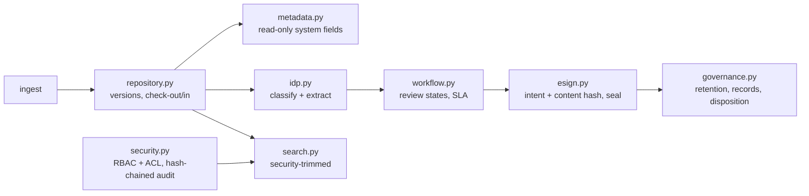

# Jagadish-document-automation

[](https://github.com/jagadishmazure-jpg/Jagadish-document-automation/actions/workflows/ci.yml)
[](https://github.com/jagadishmazure-jpg/Jagadish-document-automation/actions/workflows/codeql.yml)


**Document management lifecycle as code: repository with check-out and versions, metadata, security-trimmed search, classification and extraction, approval workflow, e-signature sealing, retention and records.**

> Personal learning and portfolio project. Everything runs offline on synthetic,
> fictional data with no API keys. Nothing is deployed. Numbers in this README
> come from real runs and are re-checked by CI (`scripts/render_docs.py --check`).

## Recruiter summary

- Covers the full document lifecycle (ingest, classify, extract, approve, sign, retain, dispose) with security and a tamper-evident audit at every step.
- Real run: invoice classified at 0.95 confidence; a second checkout is blocked; a viewer's search is security-trimmed to nothing; a tampered copy fails the seal check; a declared record is skipped at disposition.
- Deterministic offline tests; CI with lint, CodeQL, gitleaks and documented-output drift checks.

## Purpose

Most enterprise content sits in shares and inboxes with no versions, no retention
and no audit trail. This repo implements the moving parts of a document management
platform as small, testable modules, so the controls (who can see what, what must
be kept, what was signed) are explicit code rather than settings in a product. The
capability grouping is my own; see [docs/capability-map.md](docs/capability-map.md).

## Architecture



## How it works

| Capability | Module |
|---|---|
| Repository with check-out/check-in and immutable versions | `docauto/repository.py` |
| Metadata with read-only system fields | `docauto/metadata.py` |
| Full-text and metadata search, permission-checked before results | `docauto/search.py` |
| Retention policies, record declaration, disposition log | `docauto/governance.py` |
| RBAC with per-document ACLs (default deny: unspecified actions need admin) and hash-chained audit | `docauto/security.py` |
| Rule-based classification and field extraction with confidence and snippets | `docauto/idp.py` |
| Review workflow: draft, in review, approved, rejected, changes requested | `docauto/workflow.py` |
| Multi-signer envelopes, seal and verify against a content hash (mock) | `docauto/esign.py` |

## Real code and output

```python
"""One invoice through the document lifecycle: ingest, classify, version, search, approve, sign, retain (offline)."""
from datetime import datetime, timezone

from docauto.esign import SignatureService
from docauto.governance import RetentionEngine, RetentionPolicy
from docauto.idp import classify, extract_fields
from docauto.repository import DocumentStore, RepositoryError
from docauto.search import SearchEngine
from docauto.security import AccessControl
from docauto.workflow import WorkflowEngine

INVOICE = """INVOICE NO INV-2041
Bill To: Acme Corp
Invoice Date: 2026-03-15
Subtotal: $1250.00
Tax: $100.00
Amount Due: $1350.00
Payment Terms: Net 30
"""

store = DocumentStore()
v1 = store.ingest("INV-2041", INVOICE, metadata={"department": "finance"}, user="ap-clerk")
cls = classify(v1.content)
print(f"Classified as {cls.doc_type} (confidence {cls.confidence:.2f})")
for f in extract_fields(v1.content, cls.doc_type):
    print(f"  {f.name:14} = {f.value!s:12} confidence {f.confidence:.2f}")

store.checkout("INV-2041", "ap-clerk")
try:
    store.checkout("INV-2041", "other-user")
except RepositoryError as e:
    print(f"Second checkout blocked: {e}")
store.update("INV-2041", INVOICE + "PO Ref: PO-9918\n", user="ap-clerk")
store.checkin("INV-2041", "ap-clerk")
print(f"Versions kept: {store.version('INV-2041')}")

access = AccessControl()
access.set_acl("INV-2041", {"read": "editor"})
search = SearchEngine(access)
search.index("INV-2041", store.get_version("INV-2041", 2).content, {"department": "finance"})
print(f"Search 'Net 30' as editor: {[r.doc_id for r in search.search('Net 30', 'ap-clerk', 'editor')]}")
print(f"Search 'Net 30' as viewer: {[r.doc_id for r in search.search('Net 30', 'guest', 'viewer')]}  (security-trimmed)")
print(f"Audit log entries: {len(access.audit.entries())}, chain verifies: {access.audit.verify_chain()}")

wf = WorkflowEngine()
wf.submit("INV-2041")
state = wf.review("INV-2041", "approve", reviewer="controller", rationale="matches PO-9918")
print(f"Workflow state: {state.state}")

content = store.get_version("INV-2041", 2).content
sig = SignatureService()
sig.request_signature("INV-2041", ["cfo", "controller"])
sig.sign("INV-2041", "cfo", "I approve this invoice for payment", content)
sig.sign("INV-2041", "controller", "Verified against PO-9918", content)
sig.seal("INV-2041", content)
print(f"Seal verifies on original: {sig.verify_seal('INV-2041', content)}; "
      f"on tampered copy: {sig.verify_seal('INV-2041', content.replace('1350', '9350'))}")

gov = RetentionEngine()
gov.add_policy(RetentionPolicy("invoice", retention_days=7 * 365, disposition="archive"))
gov.register("INV-2041", "invoice", created_at=datetime(2018, 1, 1, tzinfo=timezone.utc))
gov.register("INV-1007", "invoice", created_at=datetime(2018, 1, 1, tzinfo=timezone.utc))
gov.declare_record("INV-1007")
for r in gov.run_disposition(as_of=datetime(2026, 10, 1, tzinfo=timezone.utc)):
    print(f"Disposition {r.doc_id}: {r.action} (policy {r.policy})")
```

Output of `python examples/demo.py` (real run, re-checked in CI):

<!-- run: python examples/demo.py -->
```text
Classified as invoice (confidence 0.95)
  total_amount   = 1350.00      confidence 0.85
  document_date  = 2026-03-15   confidence 0.80
  party          = Acme Corp    confidence 0.75
Second checkout blocked: doc 'INV-2041' is already checked out by ap-clerk
Versions kept: 2
Search 'Net 30' as editor: ['INV-2041']
Search 'Net 30' as viewer: []  (security-trimmed)
Audit log entries: 2, chain verifies: True
Workflow state: approved
Seal verifies on original: True; on tampered copy: False
Disposition INV-2041: archived (policy invoice)
Disposition INV-1007: skipped_record (policy invoice)
```
<!-- /run -->

## How to run

```bash
git clone https://github.com/jagadishmazure-jpg/Jagadish-document-automation.git
cd Jagadish-document-automation
python -m pip install pytest      # no runtime dependencies
python -m pytest -q          # offline, no keys
python examples/demo.py
python scripts/render_docs.py --check   # documented output still matches
```

Test suite size (real collection, re-checked in CI):

<!-- run: python scripts/count_tests.py -->
```text
30 tests collected
```
<!-- /run -->

## Guardrails

- Default deny: an action with no ACL entry requires the admin role.
- Search checks read permission before a document can appear in results.
- Declared records cannot be edited or disposed of; disposition logs the skip with the policy.
- A seal binds signer intent to a content hash, so any later change fails verification.
- System metadata (creator, created time, size, checksum) cannot be overwritten.
- Every access decision goes to a hash-chained audit log.

## Limitations

- In-memory stores only; nothing persists between runs.
- Classification is keyword rules on text; no OCR.
- The e-signature module is a functional mock, not a legally binding signature.
- Overlaps with Jagadish-document-intelligence (extraction, validation, ERP posting); the two are kept separate for now.

## Built vs planned

| Capability | Status | Where |
|---|---|---|
| Repository, versions, check-out/check-in | Built | `docauto/repository.py` |
| Metadata, search with security trimming | Built | `docauto/metadata.py`, `docauto/search.py` |
| Access control and hash-chained audit | Built | `docauto/security.py` |
| Classification and extraction | Built | `docauto/idp.py` |
| Workflow and e-signature mock | Built | `docauto/workflow.py`, `docauto/esign.py` |
| Retention, records and disposition | Built | `docauto/governance.py` |
| Blob storage, Purview retention labels, AI Search | Planned | docs/implementation-guide.md |
| Commercial e-signature integration | Planned | not started |

## Implementation guide

The step-by-step path from this offline build to an Azure deployment is in
[docs/implementation-guide.md](docs/implementation-guide.md). None of it has been
run; it is a plan.

## Related repositories

| Repo | How it relates |
|---|---|
| [Jagadish-document-intelligence](https://github.com/jagadishmazure-jpg/Jagadish-document-intelligence) | Extraction with confidence, money validation and guarded ERP posting |
| [Jagadish-governed-data-agent](https://github.com/jagadishmazure-jpg/Jagadish-governed-data-agent) | Deny-first access before retrieval, the same idea applied to an agent |
| [Jagadish-agentic-ai-model-risk](https://github.com/jagadishmazure-jpg/Jagadish-agentic-ai-model-risk) | Audit chains and sign-off patterns for AI decisions |
| [Jagadish-fabric-enterprise-bi](https://github.com/jagadishmazure-jpg/Jagadish-fabric-enterprise-bi) | Purview-style governance for analytical data |

## Documentation

- [Capability map](docs/capability-map.md)
- [Implementation guide (Azure)](docs/implementation-guide.md)
- [Interview points](docs/interview-points.md)
- [Security policy](SECURITY.md)

## Project layout

```
docauto/
  repository.py  documents, versions, check-out/check-in
  metadata.py    metadata index
  search.py      security-trimmed search
  security.py    RBAC + ACLs, hash-chained audit
  idp.py         classification + extraction
  workflow.py    review workflow
  esign.py       signature envelopes (mock)
  governance.py  retention, records, disposition
examples/demo.py the run shown above
tests/           offline pytest suite
```

## License

MIT, see [LICENSE](LICENSE). All data is synthetic; every organisation and person is fictional.
